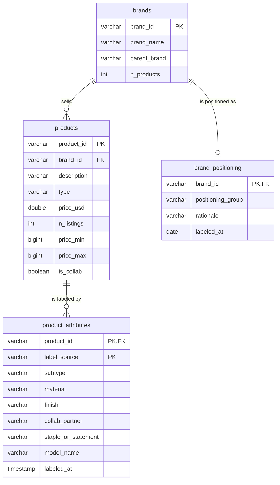

# Data dictionary

Database: `data/netaporter.duckdb`, rebuilt from scratch by `src/build_db.py`.
Source: Net a Porter product listings from Kaggle (brand, description, price in USD, type), one snapshot, no dates.

## Entity-relationship diagram

How to read it: one brand sells many products. Each product can have up to two attribute rows, one from hand labels and one from the AI. Each brand has at most one positioning label.

## Tables

### `brands`
One row per brand after cleaning.

| Column | Type | Meaning |
|---|---|---|
| `brand_id` | VARCHAR | Primary key. Short hash of the brand name, stable across rebuilds |
| `brand_name` | VARCHAR | Cleaned brand name: trimmed, uppercased, aliases merged |
| `parent_brand` | VARCHAR | Company the label belongs to (e.g. RRL → RALPH LAUREN). Same as `brand_name` unless mapped |
| `n_products` | INTEGER | Number of distinct in-scope products for the brand |

### `products`
One row per unique brand + description + type. Repeated listings are collapsed.

| Column | Type | Meaning |
|---|---|---|
| `product_id` | VARCHAR | Primary key. Short hash of brand, description, and type, stable across rebuilds |
| `brand_id` | VARCHAR | Foreign key to `brands` |
| `description` | VARCHAR | Product name as listed, with spaces cleaned (e.g. "Olie Suede Chelsea Boots") |
| `type` | VARCHAR | Product category, lowercased (clothing, shoes, accessories) |
| `price_usd` | DOUBLE | Retail price in US dollars. Median across repeated listings |
| `n_listings` | INTEGER | Number of raw rows collapsed into this product. 1 = listed once |
| `price_min` | BIGINT | Lowest price among those listings |
| `price_max` | BIGINT | Highest price among those listings |
| `is_collab` | BOOLEAN | True if the description starts with "+", the collaboration marker |

### `product_attributes` 
Structured details extracted from product names. One row per product per label source.

| Column | Type | Meaning |
|---|---|---|
| `product_id` | VARCHAR | Part of primary key. Foreign key to `products` |
| `label_source` | VARCHAR | Part of primary key. `human` (my hand labels) or `ai` (model output) |
| `subtype` | VARCHAR | Specific product, e.g. "chelsea boot", "high-top sneaker" |
| `material` | VARCHAR | Main material, e.g. "suede", "cashmere" |
| `finish` | VARCHAR | Surface treatment, e.g. "croc-effect", "two-tone". Null if none |
| `collab_partner` | VARCHAR | Collaborating brand for collab products, e.g. "Off-White" |
| `staple_or_statement` | VARCHAR | `staple` (classic, long-lived) or `statement` (trend-driven) |
| `model_name` | VARCHAR | AI model used. Null for human labels |
| `labeled_at` | TIMESTAMP | When the label was made |

### `brand_positioning` 
My editorial read of each brand, used to compare taste against pricing.

| Column | Type | Meaning |
|---|---|---|
| `brand_id` | VARCHAR | Primary key. Foreign key to `brands` |
| `positioning_group` | VARCHAR | e.g. heritage luxury, quiet luxury, designer streetwear, sportswear, contemporary |
| `rationale` | VARCHAR | One line on why the brand belongs in that group |
| `labeled_at` | DATE | When the label was made |

## Supporting tables and views

| Name | Kind | Purpose |
|---|---|---|
| `raw_products` | Table | The CSV exactly as downloaded, plus `raw_id` (row position). Kept so every step can be checked against the original |
| `cleaning_log` | Table | One row per cleaning step: rows before, after, affected, and why. Exported to `notes/cleaning_log.md` |
| `scope_types` | Table | Product types in scope. A decision, recorded in `decisions.md` |
| `brand_aliases` | Table | Brand spellings merged into one name. A decision, recorded in `decisions.md` |
| `analysis_products` | View | Products from brands with at least 20 products. The set used for modeling |

## Derived definitions

- **Price** is the listed retail price on one snapshot date, not a sale price or a sold price.
- **Collaboration** means the product name begins with "+". Collabs written another way are missed until week 3's AI extraction.
- **Comparable products** means the same `type`, `subtype`, and `material`.
